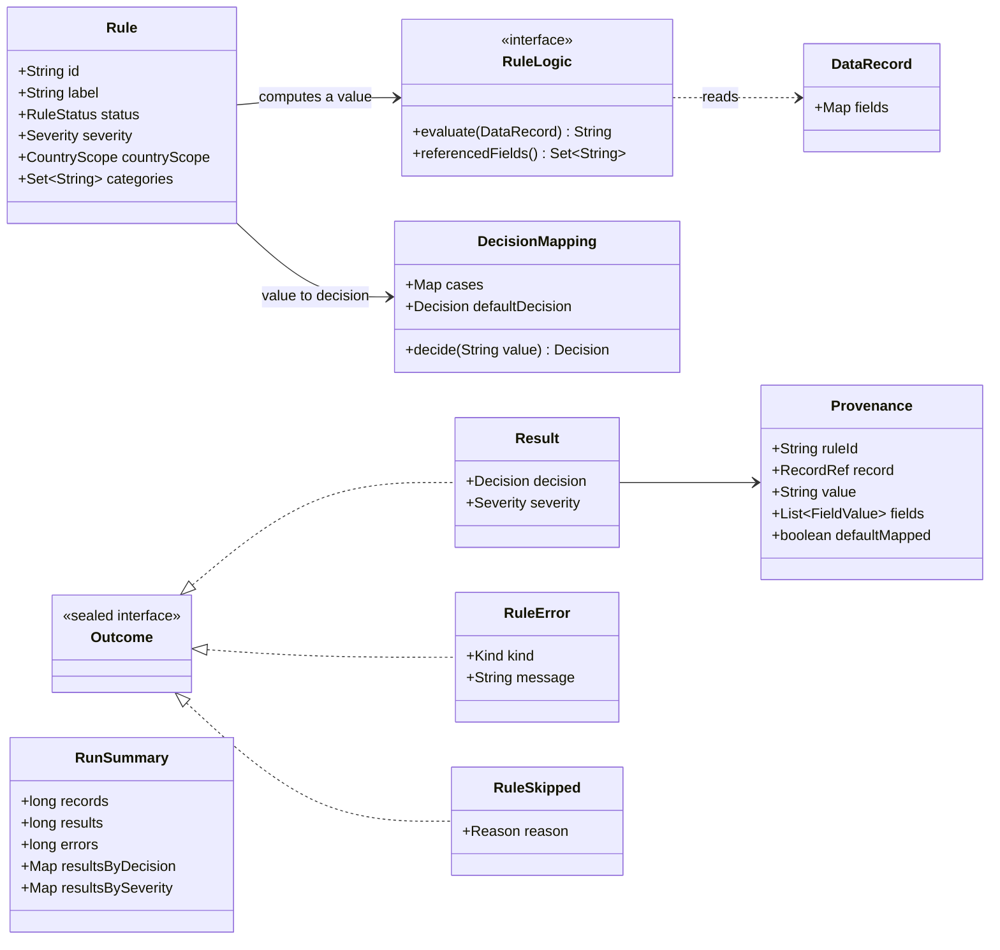
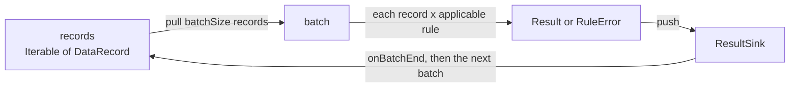
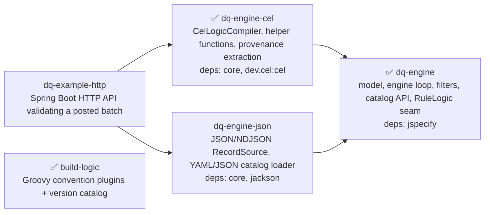
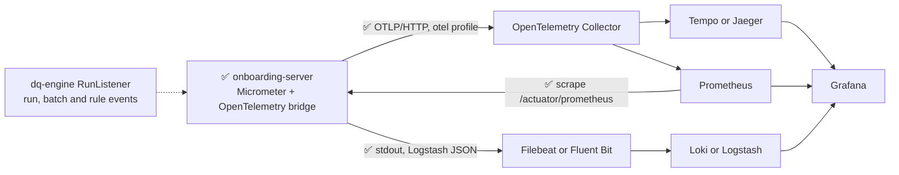

# Data-Quality Rule Engine — Design

> **Status: draft for review.** Decisions marked **(proposed)** are my recommendations and still
> need sign-off. Open questions are collected in [§9](#9-open-questions). Assumptions that need
> confirmation from architects or BAs are tracked in [§10](#10-assumptions-to-confirm). Answers
> will be folded back into the main text before submission.
>
> **Part I (§1–12)** describes the core library being built now. **Part II (§13–21)** is the
> evolution plan: observability, event log, scaling out, versioning, CI/CD, tooling, security
> testing with a tool-agnostic pipeline, and API / end-to-end testing. It is planned, except for
> the items marked ✅.
>
> **Markers:** ✅ = done (implemented, and tested where it is code). Unmarked items are designed or
> planned but not built yet. 🔍 = a proposal to investigate for possible later use, not a decision.

This document describes a reusable Java library that validates business-partner records against a
catalog of data-quality rules. HTTP APIs, batch workers and scheduled jobs embed it. The source of
truth for requirements is [`raw/REQUIREMENT.md`](raw/REQUIREMENT.md).

## Implementation status (iteration 1, first slice)

| Built and tested | Module |
|---|---|
| Model: `Rule`, `DecisionMapping` (A-1 default), `CountryScope`, `RuleStatus`, `Severity`, `Decision`, `DataRecord`, `RecordSchema` | [`dq-engine`](dq-engine) |
| Outcomes with provenance: `Result`, `RuleError` (`MISSING_FIELD`, `EVALUATION_FAILED`, `BAD_RECORD`), `RuleSkipped` (A-2) | `dq-engine` |
| Streaming `ValidationEngine.run` with configurable batch size, `ResultSink`, fault isolation, `RunSummary`; `validate` for bounded input | `dq-engine` |
| Composable `RuleFilter` (status, category, country) with the `RELEASED` guard; country-indexed rule plan (A-3); explain levels `RESULTS` and `SKIPS` | `dq-engine` |
| Rule logic as CEL: `CelLogicCompiler`, `present()`, standard macros, referenced-field extraction, missing-field and evaluation-error mapping | [`dq-engine-cel`](dq-engine-cel) |
| Requirement scenario (§5 of the task) and fault isolation, records read from the task's JSON | `dq-engine-cel` tests |
| 1M records on a 64 MB heap (streaming proven; collecting the same run fails with `OutOfMemoryError`) | `dq-engine` tests |

**Not built yet:**
- the JSON/NDJSON record source and the YAML/JSON catalog loader (`dq-engine-json`);
- the HTTP example on the new engine;
- `ValueMasker`, `RunListener`, the `TRACE` explain level, an optional `Executor`;
- CEL cost limits;
- restructuring the old onboarding modules (§8).

Today records come in as any `Iterable<DataRecord>`, and rules are built in code (`RuleCatalog.of(...)`).

Also done ✅, outside the engine:
- in the HTTP service `onboarding-server`: observability (OpenTelemetry, OTLP export, Prometheus,
  probes, §14) and logging (Log4j2, Logstash JSON);
- API test suites in [`api-tests/`](api-tests) (§21);
- the build and development environment (§8).

---

## 1. The problem in one paragraph

We get a stream of records (JSON objects describing companies) and a catalog of rules. For every
record we run every **applicable, released** rule. A rule reads some fields and computes a small
**value** such as `"ok"` or `"blocked"`. A **decision mapping** stored as data turns that value
into a **decision** (`VALID`, `INVALID`, `REVIEW` or `NOT_APPLICABLE`). Each decision is emitted as
a **result** that explains itself: which rule, which record, and which fields and values were read.
A crashing rule or a broken record becomes an **error** next to the results and never stops the run.
At the end the caller gets a **summary** with counts. The target is about 1,000,000 records per run
in bounded memory.

## 2. Reading the requirements: what is explicit, what I inferred

| Topic | What the task says | How I read it |
|---|---|---|
| Decision logic | "Keep the mapping as data, no if/else" | Rule logic is a **CEL expression** that returns a **string value**, never a `Decision`. The expression is type-checked to return `string` when the catalog is loaded. |
| Missing field | Listed as a *failure* in F3, yet `vatFormat` on r3 (no `vatId`) must give `INVALID` | A missing field is an error **only if the rule reads it unguarded**. In CEL, `record.vatId` on an absent key fails, which becomes a `MISSING_FIELD` error. A rule that tolerates absence guards with `has(record.vatId)`. |
| "Present" | `vatId present`, `iban present` | Present means non-null and non-blank. `""` counts as absent, which is why r3's IBAN is `INVALID`. |
| Applicability | "runs each applicable rule" | A rule out of scope for a record (wrong country, filtered out) is **not run** and produces **no result**. `NOT_APPLICABLE` is a decision a rule *maps to*, as `countryBlocked` does. Whether skipped rules are *reported* depends on the explain level the operator sets (§5). |
| Status | Filters on status, yet "runs RELEASED only" | The engine always adds `status = RELEASED` to whatever filter the caller passes. A status filter can narrow a run but never widen it. |
| Severity | Result carries the rule's severity | Severity is rule metadata copied onto every result, **including `VALID` ones**, so "results by severity" counts all results. |
| Batch size | "configurable by the caller" | Batch size is the unit of work: how many records are read, evaluated and flushed to the sink together. It also sets the memory bound. See §5. |
| Failure → result? | "records an error"; caller gets "results and errors" | A failed rule/record pair produces **an error and no result**. Results and errors are counted separately. |
| Purity | "purely from the record's own fields" | Rules are pure functions of one record: no I/O, no other records, no clock. This makes them safe to run in parallel and makes runs reproducible. |

## 3. Domain model

✅ Implemented in [`dq-engine`](dq-engine) as described below.



Main types (all immutable, `@NullMarked`):

| Type | Kind | Notes |
|---|---|---|
| `Decision` | enum | `VALID`, `INVALID`, `REVIEW`, `NOT_APPLICABLE` |
| `Severity` | enum | `ERROR`, `WARNING`, `INFO` |
| `RuleStatus` | enum | `DRAFT`, `RELEASED`, `DEPRECATED` |
| `CountryScope` | sealed interface | `World` or `Countries(Set<String>)`. A missing scope means `World`. |
| `Rule` | final class + builder | Validated when built: the id must be non-blank, and logic and mapping are required. Expressions are checked when they are compiled (§6). |
| `RuleLogic` | interface (seam) | `String evaluate(DataRecord record)` plus `Set<String> referencedFields()`. Core defines only the interface. The CEL module implements it, and tests or hosts can implement it in plain Java. |
| `DecisionMapping` | record | `Map<String, Decision>` plus a `Decision` default. Matching is exact and case-sensitive. If the catalog gives no default, the default is `REVIEW` (assumption A-1). |
| `DataRecord` | record | the record's fields as a map; `RecordSchema` says which fields hold the id and country. Named `DataRecord` so it doesn't clash with `java.lang.Record`. Adapters build it from Jackson nodes, `Map`s and other inputs. |
| `Result`, `RuleError`, `RuleSkipped` | records | All implement the sealed `Outcome`, so a consumer can `switch` over them exhaustively. |

### Rule logic: CEL expressions

✅ Implemented in [`dq-engine-cel`](dq-engine-cel) with CEL 0.14.0: `CelLogicCompiler`, the `present()`
helper, the standard macros, and compile-time rejection of invalid expressions and non-string results. The
YAML catalog file shown below is the planned format, not built yet; today the same rules are built in
code (`FixtureRules` in the tests).

Rule logic is written in [CEL (Common Expression Language)](https://cel.dev), Google's expression
language for policies (`dev.cel:cel`). The whole rule is then data: the expression, the mapping and
the metadata sit together in the catalog, and adding a rule needs no deploy.

Why CEL and not another expression language:

| | CEL | JEXL / MVEL / SpEL |
|---|---|---|
| Side effects / I/O | none possible | can call arbitrary Java methods unless sandboxed |
| Termination | guaranteed (no unbounded loops) | not guaranteed |
| Type-check at load time | yes (we declare the result must be `string`) | mostly at run time |
| Cost limits | built in (cost estimation per expression) | no |
| Performance | compile once, evaluate many times | similar |
| Downside | pulls protobuf + Guava, so it lives in its own module | lighter (JEXL) / Spring-bound (SpEL) |

CEL's guarantees match the requirement that a rule reads only the record's own fields. They also remove
a problem noted in §12, where a rule stuck in an infinite loop could not be stopped.

The fixture catalog:

```yaml
- id: countryBlocked
  label: Country is not blocked
  status: RELEASED
  severity: ERROR
  logic: 'record.country == "ZZ" ? "blocked" : "ok"'
  decisions: { blocked: INVALID }
  default: NOT_APPLICABLE

- id: vatFormat
  label: VAT ID has a plausible length
  status: RELEASED
  severity: ERROR
  categories: [tax]
  logic: 'present(record, "vatId") && size(record.vatId) >= 9 ? "ok" : "bad"'
  decisions: { ok: VALID, bad: INVALID }
  # no default → REVIEW (assumption A-1)

- id: ibanFormat
  label: IBAN matches the record's country
  status: RELEASED
  severity: ERROR
  categories: [banking]
  logic: 'present(record, "iban") && record.iban.startsWith(record.country) ? "ok" : "bad"'
  decisions: { ok: VALID, bad: INVALID }
```

`present(record, field)` ✅ is a small custom CEL function the library provides: the key exists, is a
string and is not blank. Other helpers (`blank`, `digitsOnly`, `mod97`) can be added the same way
through a function registry. A catalog may also define its own functions in Java (Q-B).

**Provenance from expressions** ✅: when an expression is compiled, the engine collects every
`record.<field>` it references from the checked syntax tree. Each result records those fields with
their values for that record. This is "fields the rule references", which may be slightly more than
the fields read on the branch that actually ran. In return it is cheap, exact and does not depend on
CEL internals.

## 4. Public API and why it is shaped this way

✅ Implemented as shown (`dq-engine`, `dq-engine-cel`).

```java
CelLogicCompiler cel = CelLogicCompiler.create();                  // immutable, thread-safe, reusable

Rule vatFormat = Rule.builder("vatFormat")
        .status(RuleStatus.RELEASED)
        .logic(cel.compile("present(record, 'vatId') && size(record.vatId) >= 9 ? 'ok' : 'bad'"))
        .mapping(DecisionMapping.when("ok", Decision.VALID).when("bad", Decision.INVALID).withImplicitDefault())
        .build();

ValidationEngine engine = ValidationEngine.builder()
        .catalog(RuleCatalog.of(vatFormat /* , ... */))               // later also: a YAML/JSON catalog loader
        .build();                                                       // immutable, thread-safe, reusable

RunSummary summary = engine.run(
        records,                                                        // any Iterable<DataRecord>, pulled lazily
        sink,                                                           // results + errors pushed as produced
        RunOptions.DEFAULT
                .withFilter(RuleFilter.category("tax").and(RuleFilter.country("DE")))
                .withBatchSize(1_000));
```

```java
public interface ResultSink {
    void onResult(Result result);
    void onError(RuleError error);
    default void onSkipped(RuleSkipped skipped) {}  // only at ExplainLevel.SKIPS
    default void onBatchEnd(BatchInfo batch) {}     // a place to commit, flush or checkpoint
}
```

Why this shape:

- **One entry point with three inputs: where records come from, which rules run, and where outcomes
  go.** Each one is an interface the host can replace. The engine owns only the evaluation loop.
- **Push sink, not a returned list.** A list would hold all results in memory and break F5. A pushed
  sink keeps memory bounded, and because the sink is called synchronously, a slow sink slows the
  engine down (natural backpressure). The summary is returned once the run finishes.
- **A convenience method for small inputs.** `engine.validate(List<DataRecord>) → ValidationReport`
  collects results, errors and the summary. The tests use it, and so will the planned HTTP example. Its
  javadoc says it is for bounded input only.
- **Values, not exceptions, for expected outcomes.** `INVALID` is a normal result, and a crashing rule
  is a normal `RuleError`. The engine throws only when the caller made a mistake (bad options, an
  invalid catalog) or when the host's own sink throws.
- **Immutable and built once.** The engine checks the catalog (e.g. duplicate rule ids) when it is
  built. Each run selects its rules and indexes them by country once. Rule logic must be thread-safe, and
  pure logic is.
- **A small, explicit API.** The JPMS module `com.example.dq.engine` exports one package; helpers such as
  the rule plan and the counters are package-private. Null-safety is stated with JSpecify.

## 5. Bounded memory and streaming



- ✅ **What stays in memory:** the compiled rule plan (size depends on the number of rules), one batch of
  records and its outcomes (size depends on batch size × rules per record), and the summary counters
  (fixed size: an `EnumMap` of `long`s). **None of this grows with the total number of records.**
- ✅ **What is never kept:** past records, past results, past errors. Errors are streamed like results,
  because a broken rule on 1M records means 1M errors.
- ✅ **Country lookup is O(1).** The plan groups rules by country, so the rules for a record are
  `world rules + rules for that country`. The engine does not scan the whole catalog for each record.
- **Reading input** (planned, `dq-engine-json`): `RecordSource.jsonArray` will use Jackson's streaming
  `JsonParser`, so a 1M-element array is never loaded at once. NDJSON (one record per line) will be
  supported too, and recovers better from a malformed record.
- **Parallelism (decided):** sequential on the caller's thread by default ✅, and the library never
  starts threads of its own ✅. Planned: the host can pass an `Executor`, and the engine then evaluates a
  batch in parallel and still emits outcomes in input order, so results stay reproducible. Distributing
  work across machines would be the job of the host's platform (proposals to investigate in §16).
- ✅ **Proof:** `BoundedMemoryTest` generates 1,000,000 records lazily and counts outcomes in a sink while the test JVM
  runs with a 64 MB heap. Collecting the same run in memory fails with `OutOfMemoryError`.

Known limitation: checks that need the whole run, such as detecting duplicate record ids across the
input, would need memory proportional to N. They are out of scope; rules see only one record.

### Country scope and the cost of wide rules

✅ A rule applies to a record **only** when its scope is `WORLD` or its country equals the record's
country. This check is always on and can't be switched off. `RuleFilter.country(...)` can narrow a
run further but never widen it. A record with no country or an unknown country (r3's `ZZ`) gets
`WORLD` rules only (assumption A-3).

> ⚠️ **Treat `WORLD` rules with caution.** A `WORLD` rule runs on *every* record, so its cost is
> `N × cost(rule)`. One slow or failing `WORLD` rule dominates run time, or the error count, of every
> run. Prefer a country scope whenever a rule is really country-specific. Planned guards:
> - catalog lint: a `WORLD` rule whose CEL cost estimate is above a threshold needs explicit approval;
> - per-rule metrics and traces (§14), so a hot rule is visible on a dashboard after its first run;
> - a per-rule circuit breaker that stops a rule after N failures in a run (§13, iteration 2).

### Explain level (operator-controlled)

How much the engine reports beyond results and errors is set by the **operator or administrator**,
not by each API caller. It works like a log level:

| Level | Emitted | Typical use |
|---|---|---|
| `RESULTS` (default) ✅ | results, errors, summary. Skipped rule/record pairs are only *counted* (`RunSummary.skipped`). | production runs at 1M records |
| `SKIPS` ✅ | also one `RuleSkipped(record, rule, reason)` event per rule that didn't apply | "why didn't rule X run on record Y?" |
| `TRACE` | also per-evaluation timing and every referenced field value | profiling, debugging one batch |

Skips are separate `RuleSkipped` events and **not** `NOT_APPLICABLE` results, so the F4 summary
counts don't change with the level (assumption A-2) ✅. In the planned HTTP example the level will be a
server setting (`dq.explain-level`), not a request parameter.

## 6. Fault isolation

| Failure | Detected where | What happens |
|---|---|---|
| ✅ Rule logic throws, or returns `null` (bug, NPE, parse error) | around each *rule × record* evaluation | `RuleError(kind=EVALUATION_FAILED)` with record id and position, rule id, the referenced fields with their values, and the exception class and message. The next rule runs. |
| ✅ Record unreadable (e.g. its country is not text) | engine, before any rule runs | `RuleError(kind=BAD_RECORD, ruleId=null)`. The record is skipped and the batch continues. |
| ✅ Invalid expression (CEL syntax or type error, non-string result) | `CelLogicCompiler.compile` | `RuleCompilationException` before any record is validated. |
| ✅ Duplicate rule ids | `ValidationEngine.builder().build()` | **Fails fast before the run.** Configuration errors should be loud. |
| Invalid catalog file (bad decision name, bad structure) | catalog loader (planned) | Fails fast with every problem listed. |
| ✅ CEL evaluation error (absent key, wrong type, e.g. `startsWith` on a number) | around each evaluation | `RuleError(kind=MISSING_FIELD)` for an absent key, `RuleError(kind=EVALUATION_FAILED)` otherwise, mapped from the CEL error. |
| ✅ Host sink (or record source) throws | engine | Not isolated: it is the host's own code. The run stops with `RunAbortedException`, which carries the summary so far. |
| ✅ `OutOfMemoryError` and other `VirtualMachineError`s | — | Not caught. The JVM is in an unknown state. `StackOverflowError` from a host's Java `RuleLogic` *is* caught. |

✅ Every error carries enough to locate its cause: record id **and** position in the input (a record
may have no id), rule id, the fields the rule references with their values, and the exception type.

## 7. Seams for host-supplied inputs

| Seam | Interface | Shipped implementations | Example host implementation |
|---|---|---|---|
| Where records come from | any `Iterable<DataRecord>` today ✅; a `RecordSource` (`AutoCloseable`) with the JSON module | JSON array, NDJSON (planned) | DB cursor, message topic, S3 file |
| What a record looks like | `DataRecord` + `RecordSchema` (which field is the id or country) ✅ | from a `Map<String,?>` ✅; Jackson `JsonNode` (planned) | Avro/Protobuf view |
| Where rules come from | `RuleCatalog` ✅ | in code ✅; JSON/YAML file (planned) | rule-management service, DB |
| How rule logic is defined | `RuleLogic` + `CelLogicCompiler` ✅ | CEL compiler with the `present` helper ✅; plain Java via `RuleLogic.of` ✅ | plain-Java logic, another expression language |
| Extra CEL functions | `CelFunctionLibrary` (ServiceLoader SPI) | `present` ✅ (built in); `blank` (planned) | `mod97`, company-specific checks |
| Which rules run | `RuleFilter` (`and` / `or` / `not`) ✅ | by status, category, country ✅ | by owner team, by tag |
| Where outcomes go | `ResultSink` ✅ | collecting (`validate`) ✅; NDJSON writer (planned) | DB writer, message topic |
| Threads | `Executor` (optional) | none (runs on the caller's thread) | host's pool |
| Masking sensitive values | `ValueMasker` (per field) | none, so raw values are kept (decided) | IBAN masked except the last 4 characters |
| Observability | `RunListener` (run, batch and rule events, gated by explain level) | no-op | OpenTelemetry, Micrometer, event log (§14–15) |

The core module depends only on JSpecify ✅. CEL (protobuf, Guava) lives in its own module ✅, and Jackson
will too, so a host pays only for what it uses (Q-C).

## 8. Module layout (decided: restructure this repo)

The existing code implements a business-partner onboarding service with duplicate detection. It will be
replaced by the modules below. Kept: `build-logic` convention plugins, `gradle/libs.versions.toml`, Nix
dev shell, strict compiler and javadoc settings.



✅ = built. `dq-engine-json` and `dq-example-http` are still to come.

To be removed in the restructure (not done yet; these modules still exist and work): `onboarding-application`, `partner-quality` (its IBAN/VAT code can
come back as CEL functions), duplicate detection and the ADRs that describe them.

**Monorepo now, split later** ✅ (in place). Today everything lives in one repository: library, adapters, example
host, build logic and docs. This speeds up the initial implementation. A change that crosses modules
is one commit and one review, the build is shared, and nothing has to be released before another
module can use it. Splitting is worth considering once **churn makes the repository hard to work in
for several teams**, for example:
- teams block each other on reviews or CI;
- unrelated changes break each other's builds;
- modules need different release cadences.

The code is built so that the split costs little:
- **Separate Gradle modules with explicit dependencies.** Each module already has its own build file,
  public API (JPMS `module-info`) and tests. Moving one into its own repository changes a project
  dependency into a Maven-coordinate dependency, and nothing else.
- **Hexagonal architecture (ports and adapters).** The core depends on nothing outside itself, and
  adapters depend on the core, never the other way round. A host or adapter can therefore move to
  another repository, or be owned by another team, without touching the core.
- **Shared build conventions in `build-logic`.** These can be published as a Gradle plugin and reused
  by the new repositories.
- **A published, semantically versioned library** (§17) is the contract between the repositories once
  they are split.

**Development environment: Nix** ✅. I chose a Nix flake (with direnv) for two reasons:
- **Reproducibility:** `flake.lock` pins the exact JDK 21, Gradle and tool versions. Every developer
  machine and CI run uses the same toolchain.
- **Easy setup:** `direnv allow` or `nix develop` is the only step. You don't install a JDK or Gradle by
  hand, and nothing is installed globally.

The Gradle wrapper and the foojay toolchain resolver stay in place, so the project also builds without
Nix. Nix covers only the development and CI toolchain. Runtime packaging uses Dockerfiles, Helm and
Terraform (§18).

HTTP example (Spring Boot, decided; not built yet): `POST /api/v1/validations` with a JSON array of records and optional `category` and
`country` query parameters. It returns `{ summary, results[], errors[] }`. With
`Accept: application/x-ndjson` it streams outcomes line by line, so large batches use the same
streaming path.

## 9. Open questions

Decided so far:
- the repo is restructured (§8): new modules added ✅, old ones not removed yet;
- rule logic is written in CEL (§3) ✅;
- the HTTP example uses Spring Boot (§8);
- an unmapped value falls back to `REVIEW` (A-1) ✅;
- evaluation is sequential ✅, with an optional host `Executor` (§5);
- country scope is always on, and wide rules need care (§5) ✅;
- skips are reported according to the explain level (§5) ✅;
- provenance keeps raw values ✅, with a masking hook (§7).

Each remaining question lists my suggestion first.

- **Q-B — Can a catalog bring its own CEL functions?** *Suggestion:* yes, through a ServiceLoader
  `CelFunctionLibrary`, but only from Java on the host's classpath, never from the catalog file.
- **Q-C — Where do CEL and Jackson live?** *Suggestion:* each in its own adapter module (§8), so core
  stays at zero dependencies. ✅ Done this way for CEL.
- **Q-F — Should a run that selects no rules (e.g. status filter `DRAFT`) be an error?** *Suggestion:*
  no. The summary reports `rulesSelected = 0`. ✅ Built this way.
- **Q-H — What identifies a record?** *Suggestion:* the id when present, plus the position in the
  input, which is always there. A missing id is not a failure. ✅ Built this way.
- **Q-I — Should the rule version be in provenance?** *Suggestion:* store the catalog version (and the
  rule version if present) in every result.
- **Q-K — Which API-test tool is primary, Bruno or SoapUI?** *Suggestion:* Bruno (§21). It is git-friendly
  and its CLI is free. Keep SoapUI only if the people who consume the API use it.
- **Q-J — What package or group name should the code use?** The code currently uses `com.example.dq.*`,
  matching the existing modules. *Suggestion:* a neutral namespace such as
  `io.github.<you>.dq`.

## 10. Assumptions to confirm

These are things the requirements leave open. The implementation picks a reasonable answer so work can
continue, but **an architect or BA must confirm each one before it is final.** Each one has a stable
id. The code marks the exact place with `// ASSUMPTION(A-n): …` and a test named after it, so
`grep -rn "ASSUMPTION(A-"` lists every spot to revisit and a changed answer breaks a known test.

| Id | Assumption | Why it is open | Where in code | Status |
|---|---|---|---|---|
| **A-1** | A computed value that has no entry in the decision mapping, in a rule with no explicit `default`, maps to **`REVIEW`**. | The domain model says every mapping has a `default`, yet the fixture rules `vatFormat` and `ibanFormat` define none. `REVIEW` sends an unexpected value to a human instead of silently passing or failing it. Alternatives: report a `RuleError`, or reject the catalog. | `DecisionMapping` (fallback default), `RuleCatalog` loader | ✅ implemented · ⏳ **TODO: confirm with architects / BA** |
| **A-2** | A rule that didn't apply to a record is reported, at explain level `SKIPS` or higher, as a separate `RuleSkipped` event. It is never a `NOT_APPLICABLE` result. | The task makes `NOT_APPLICABLE` a decision. Reporting skips as results would change F4 counts depending on configuration. | engine loop, `ResultSink.onSkipped` | ✅ implemented · ⏳ **TODO: confirm with architects / BA** |
| **A-3** | A record with no country, or an unknown country such as `ZZ`, gets only `WORLD` rules. | The task defines matching only for a record that has a valid country. | rule plan lookup | ✅ implemented · ⏳ **TODO: confirm with architects / BA** |

The A-1 fallback is one constant (`DecisionMapping.IMPLICIT_DEFAULT`), so changing the answer is a
one-line change plus the test `A1_unmappedValueWithoutDefaultIsReview`.

## 11. Testing

- ✅ **Fixture scenario:** a table-driven test of the 3 records × 3 rules from the task, with exact
  decisions and provenance (`RequirementScenarioTest`, records read from the task's JSON).
- ✅ **Fault isolation:** a rule that reads a field absent from one record without a guard, and one
  malformed record. The run completes, the other results are present, and errors point to the cause
  (`FaultIsolationTest`).
- ✅ **Unit tests:** decision mapping (hit, explicit default, A-1 implicit default), filters (composition,
  RELEASED guard), country plan, CEL compilation errors, `present()` (missing, blank, wrong type),
  provenance field extraction.
- **Scale:** 1M generated records on a 64 MB heap ✅ (`BoundedMemoryTest`), plus a JMH benchmark (next).
- **Architecture:** an ArchUnit test that the engine core depends on nothing but the JDK and JSpecify
  (planned; ArchUnit rules exist so far for the onboarding modules ✅).
- ✅ Run everything with `./gradlew test`: 146 tests, with a summary line per module.

## 12. Trade-offs and what I'd do next

**Trade-offs taken now:**
- Decision values are strings with exact matching. Ranges, regexes and numeric thresholds in mappings
  are not supported yet.
- CEL brings protobuf and Guava. This is contained in `dq-engine-cel`, but that module is the heaviest
  dependency.
- Provenance lists the fields an expression *references*, not only those read on the branch that ran.
- A host's plain-Java `RuleLogic` has no timeout. CEL expressions always terminate, but Java code
  can't be interrupted safely in-process.
- A run is not resumable. `onBatchEnd` gives the host what it needs to build checkpoints itself.

**Next:**
1. `dq-engine-json`, so rules can live in a catalog file.
2. The rule engine's HTTP example.
3. Then a per-rule circuit breaker, CEL cost limits, and the engine's `RunListener` (see Part II).

---

# Part II — Evolution plan

> Everything below is **planned, not built**, except the items marked ✅. Iteration 1 is the core library; the later iterations
> plug in through the seams in §7 and need no change to the core. The goal of this part is to show
> the core doesn't block any of these directions.

## 13. Iteration plan

| Iteration | Scope | Outcome |
|---|---|---|
| **1: core (now)** | model ✅, CEL logic ✅, decision mapping ✅, filters ✅, streaming engine ✅, fault isolation ✅, summary ✅, explain level ✅ (`RESULTS`, `SKIPS`), tests ✅; still to do: `RunListener` seam, JSON adapter, Spring Boot example, the `verify` pipeline stage (§20) | the task's deliverables |
| **2: operate it** | OpenTelemetry in the HTTP service ✅ (engine adapter still to do), JFR events, Prometheus + Grafana stack (docker-compose), NDJSON event log, circuit breaker, CEL cost limits, full CI pipeline, Dockerfiles | you can see what rules cost and how they behave |
| **3: trust it** | event log on a message broker (e.g. Kafka), catalog pipeline (lint, golden tests, shadow runs), catalog and API versioning checks, Helm charts, Terraform, release to Maven Central | rules and code ship safely and independently |
| **4: scale it** | 🔍 investigate distributed platforms (Kafka Streams, Spark, Flink, Temporal, Airflow; §16), result cache | billions of records, continuous validation |
| **5: open it** | rule admin panel, steward review inbox, n8n / LangChain4j / MCP integrations | business users and other tools can work with rules |

## 14. Observability and rule profiling (iteration 2)

**Already in place ✅ (in the HTTP host, `onboarding-server`, ADR-0011):**
- Micrometer with the OpenTelemetry bridge, and W3C trace propagation;
- trace and span ids in the logs;
- OTLP/HTTP export of traces and metrics with the `otel` profile;
- `/actuator/prometheus`, and Kubernetes liveness and readiness probes.

What follows is for the rule engine itself.

**Instrumentation.** OpenTracing has been superseded by **OpenTelemetry (OTel)**, so OTel is the
standard to use. A `dq-engine-otel` module implements `RunListener` against the OTel **API** only. The
host configures the SDK and exporters, and core stays dependency-free.

| Signal | What | Careful with |
|---|---|---|
| Traces | one span per run, one child span per batch, per-record spans **only when sampled** or at `TRACE` | a span per rule × record would be 30M spans for 1M records × 30 rules. Never do that by default. |
| Metrics | records processed, results by decision and severity, errors by kind and rule, skips, batch duration, `dq.rule.evaluation.duration` histogram per `rule.id` | label cardinality: `rule.id` is bounded by catalog size. **Never** use a record id as a label. |
| Logs | run start and end with summary, catalog load problems, circuit-breaker trips. The host already logs through SLF4J with Log4j2, and the `json-logs` profile writes Logstash JSON to stdout ✅ (ADR-0009); the core library has no logging dependency ✅ | no field values unless masked |



✅ = in place on the application side. The collector, backends and dashboards are planned.

**Stack:** OTel SDK → OTel Collector → **Prometheus** (metrics), **Tempo or Jaeger** (traces),
**Loki** (logs and event log) → **Grafana** dashboards and alerts. The HTTP service already uses
Micrometer with the OTel bridge and exposes `/actuator/prometheus` ✅. A `docker-compose` file will start
the whole stack locally.

**Dashboards and alerts:**
- run overview: throughput, duration, error rate;
- rule health: top-N slowest rules, top-N failing rules, `WORLD` rules ranked by total cost;
- decision drift: a sudden jump in `INVALID` after a catalog release usually means a bad rule rather
  than bad data. Alert on it.

**Profiling rules:** three complementary tools:
1. **Static cost:** the CEL cost estimate per expression, computed when the catalog loads. It gives a
   ranking before any data is processed.
2. **JFR events:** a custom `jdk.jfr.Event` (`dq.RuleEvaluation`) with a duration threshold. JFR is
   part of the JDK, cheap when off, and readable in JDK Mission Control. It needs no dependency, so it
   can live in core.
3. **Traces and event log:** sampled per-record spans and `TRACE`-level events show what one slow
   record did. Aggregating the event log answers "what did rule X cost last month?".

## 15. Event log (iterations 2–3)

**Purpose:** an append-only, immutable history of what the engine decided and why. It serves four
needs:
- **audit:** "why was partner X flagged on 3 Nov with rule version 7?";
- **replay:** re-process after a fix;
- **analytics:** decision trends per rule and country;
- **profiling:** see §14.

**Design.** The event log is a `ResultSink` + `RunListener` implementation, so it needs no core
changes.

| Aspect | Plan |
|---|---|
| Events | `RunStarted` (run id, catalog version, options, host), `ResultEmitted`, `RuleFailed`, `RuleSkipped` (by explain level), `BatchCompleted`, `RunCompleted` (summary) |
| Envelope | [CloudEvents](https://cloudevents.io) style: `id`, `type`, `schemaVersion`, `runId`, `time`, `data` |
| Idempotency | deterministic id = hash(runId, record position, ruleId), so retried batches deduplicate downstream |
| Transport | iteration 2: NDJSON file sink. Iteration 3: a message-broker topic keyed by record id (ordered per record), with a schema registry. Kafka is one option (🔍 §16). |
| Storage / query | broker retention plus a compacted "latest decision per record × rule" topic, then columnar storage (Parquet on object storage, or ClickHouse) for analytics |
| Privacy | `ValueMasker` runs before writing. Retention period agreed with data protection. |

## 16. Scaling out: distributed processing and caching (iteration 4)

> 🔍 **Proposals to investigate, not decisions.** The platforms below are options to keep in mind and to
> investigate *if* a concrete need appears: volumes beyond one JVM, continuous instead of batch validation,
> long-running orchestration, or a human review step. None is chosen. None is needed for the current
> requirement either: a single JVM already streams 1M records in bounded memory (`BoundedMemoryTest` ✅).
> Whether to incorporate one is decided only after a proof of concept, and recorded as an ADR.

The engine is a pure function of (catalog version, record). That is what would make it easy to embed in a
distributed platform. **The library stays a library**: a platform would get a thin runner module, and the
core wouldn't change.

| Proposal 🔍 | Could fit for | How the engine could plug in |
|---|---|---|
| **Kafka / Kafka Streams** | continuous validation of partner changes | `mapValues` → outcomes topic. Kafka transactions give exactly-once delivery. |
| **Apache Flink** | streaming with state, catalog hot reload | build the engine in `open()`. Push catalog updates to all tasks with the *broadcast state* pattern. |
| **Apache Spark** | bulk re-validation of 100M+ records | `mapPartitions` with one engine per executor. The catalog text is broadcast and compiled on each worker. |
| **Temporal** | durable orchestration of long runs, and the human `REVIEW` step | a workflow splits the input into chunks and an activity runs the engine on each chunk, with retries and checkpoints (via `onBatchEnd`). A `REVIEW` decision starts a steward workflow that waits for a human signal. |
| **Airflow** | scheduling batch runs as DAGs (nightly re-validation) | a task that calls the batch host. Only worth it if the organisation already runs Airflow. |

**How to decide, if a need appears:**
1. State the need in numbers: records per run or second, latency, duration, any human step.
2. Check what the organisation already runs and can operate.
3. Run a proof of concept with the task's fixture and the 1M-record generator, and measure.
4. Record the result, including the options rejected, as an ADR.

First questions per proposal:
- **Kafka Streams:** is there a stream of partner changes?
- **Spark:** are volumes really beyond a few JVMs?
- **Flink:** does any rule need state across records? (Today's rules don't.)
- **Temporal:** are runs long enough to need durable orchestration, or is a human `REVIEW` workflow in
  scope?
- **Airflow:** does the organisation already use it? A Kubernetes `CronJob` may be enough.

**What any of these would require from iteration 1:**
- no static state ✅;
- no threads started by the library ✅;
- deterministic results, so retries are safe ✅;
- a catalog that is plain text plus a version, so it can be shipped to workers (planned with the catalog
  loader). Compiled CEL programs aren't serializable, so each worker would compile and cache them.

**Caching:**
- *Compiled catalog cache:* compile once per catalog hash, per JVM. This matters most on Spark and
  Flink workers.
- *Result memoization:* rules are pure and we know which fields each one references, so
  `(ruleId, ruleVersion, values of referenced fields)` is an **exact** cache key. Re-validating
  1B mostly unchanged records then evaluates only what changed. Use Caffeine in-process and Redis
  when shared. Hook it in as a decorator around `RuleLogic`.

## 17. Versioning: persistence and APIs (iteration 3)

| What | Strategy |
|---|---|
| **Java library API** | semantic versioning, checked by **japicmp** in CI against the last release; `@API(status = EXPERIMENTAL)` (apiguardian) on unstable types; deprecate in a minor, remove no earlier than the next major |
| **Catalog format** | `apiVersion: dq/v1` at the top of the file (as in Kubernetes). The loader reads the current and previous version. |
| **Rules** | each rule has a version, and a released catalog is immutable. Every result carries `catalogVersion`, `ruleId` and `ruleVersion`. Keep the catalog in Git ("rules as code"), so a PR review is the `DRAFT → RELEASED` gate. |
| **CEL functions** | part of the catalog contract: never change what an existing function means. Add a new name instead. |
| **HTTP API** | major version in the URI (`/api/v1`) ✅ (onboarding API); additive changes only within a major. The OpenAPI spec is the contract, checked with `openapi-diff` in CI. `Deprecation` and `Sunset` headers before a removal. |
| **Events** | `schemaVersion` in the envelope; schema registry with backward compatibility; upcasters for old events on replay |
| **Persistence (results store, if added)** | Flyway migrations; *expand → migrate → contract* for zero-downtime changes; never change the meaning of an existing column |

## 18. Deployment and CI/CD (iterations 1–3)

**Code pipeline:** defined independently of the CI tool, with its stages, tools, commands and
security tests, in §20. A release happens on a git tag: the semantic version comes from the tag,
artifacts are signed and published to Maven Central, jars are reproducible (already configured ✅), and a
changelog is written.

**Catalog pipeline:** rules are data, so they ship **independently of code**:
1. Lint: every CEL expression compiles against the target library version, and decision names are
   valid.
2. Golden records: a sample record set with the expected decision for each rule.
3. Cost check: `WORLD` rules above the cost threshold need approval (§5).
4. **Shadow run:** a new or changed rule runs on a production sample and a decision-diff report is
   produced before release.
5. Promote the catalog dev → staging → prod. Services reload it, or pick it up at the next start.

**Packaging and infrastructure (future, not part of iteration 1):**

| Artifact | Purpose | Iteration |
|---|---|---|
| **Dockerfiles** | one per deployable host (HTTP example, batch worker): a multi-stage build (JDK build stage, then a slim JRE runtime image), running as a non-root user | 2 |
| **docker-compose** | local stack: the example service plus Prometheus, Grafana, Tempo and Loki (§14) | 2 |
| **Helm charts** | Kubernetes deployment of the hosts: Deployment/Service for the HTTP API, `Job`/`CronJob` for batch and scheduled runs, probes, resources, config, the catalog as a ConfigMap | 3 |
| **Terraform** | the infrastructure underneath: Kubernetes cluster, container registry, a message broker if one is chosen, storage for the event log, observability backends, per environment (dev, staging, prod) | 3 |

**Runtime:** the HTTP example runs on Kubernetes, deployed with its Helm chart. Liveness and readiness
probes come from Actuator (already exposed ✅), configuration from the environment, and the catalog from a ConfigMap or a
catalog service. Batch and scheduled hosts run as Kubernetes `Job` / `CronJob`, or under a workflow engine if one is
adopted (🔍 §16).

## 19. Tooling around the engine (iteration 5)

**Rule admin panel:**
- Catalog browser: filter by status, category and country; version history and diffs.
- CEL editor with live compile errors, backed by a `POST /rules:compile` endpoint.
- **Try it:** paste a record, see the computed value, decision and provenance.
- Decision-mapping table editor.
- Lifecycle `DRAFT → RELEASED → DEPRECATED` with four-eyes approval, plus the shadow-run report.
- **No-code builder** for business users: form blocks such as *field `vatId` · length ≥ · 9* that
  generate CEL. CEL stays the stored format, so power users can still edit the text.
- *Build vs buy:* DMN decision tables (Camunda, Drools) are an industry-standard form of exactly our
  "decision mapping". Worth evaluating before building a custom editor.

**Steward inbox (CRM-like):** `REVIEW` results go into a work queue where a data steward accepts or
corrects the record. It could be driven by a workflow engine; Temporal is one proposal (🔍 §16).

**Rule dependencies / DAGs:** today's rules are independent (the requirement says "purely from the
record's own fields"). If a dependency appears ("run B only if A is `VALID`"), model it as an explicit
DAG in the catalog and evaluate in topological order, with a DAG view in the admin panel. Do this
**only when a real requirement appears**: dependencies remove the independence that makes rules
parallel and cacheable. Orchestration DAGs (which runs execute when) belong in a scheduler or workflow
engine (e.g. Airflow or Temporal, 🔍 §16), not in the engine.

**Integrations:**
- **n8n:** the HTTP API works as-is through the HTTP node. A small community node ("Validate business
  partner") would make it one click, e.g. new CRM contact → validate → route by decision.
- **MCP server / LangChain4j / LangGraph tools:** expose `validate_record`, `explain_result` and
  `list_rules` as tools, so agents can call the engine deterministically.
- **LLM-assisted rule authoring:** describe a rule in natural language → a CEL draft. It is
  **always `DRAFT`**, goes through golden tests and human approval, and is never released by an LLM.
- **LLM-assisted review triage:** summarise why a record is in `REVIEW`, using the provenance as
  context.
- **Guardrails:** the deterministic engine remains the only decision-maker. `ValueMasker` runs
  before any data leaves for an external model.

## 20. Security testing and a tool-agnostic pipeline (iterations 1–3)

> Planned, not built. ✅ Today the build already gives: compilation with `-Xlint:all -Werror` for
> libraries, javadoc lint, unit, integration and architecture tests (ArchUnit), JUnit XML reports, a
> per-module test summary, and reproducible jars.

### Principle: the pipeline lives in the repository, the CI tool only calls it

We haven't chosen the CI tool yet (GitHub Actions, GitLab CI, Jenkins, Azure DevOps, …). So **every
pipeline step is a command in this repository**:
- Gradle tasks for everything on the JVM;
- small scripts in `ci/` for everything else.

Any CI job reduces to one line, and every step can be run locally in exactly the same way:

```bash
nix develop -c ci/verify.sh        # same toolchain as on a laptop: versions pinned by flake.lock
```

| Rule | Why |
|---|---|
| Steps are `ci/<stage>.sh` scripts calling Gradle and CLI tools, never logic written in CI-tool YAML | switching CI tools means rewriting a few one-line wrappers, not the pipeline |
| Tool versions are pinned in `flake.nix` (or as container images pinned by digest when a tool isn't packaged) | the same results locally and in CI, and upgrades are reviewed changes |
| Results use standard formats: **JUnit XML** (tests), **SARIF** (security findings), **CycloneDX** (SBOM), **JaCoCo XML** (coverage) | every CI tool and code-review platform can display them |
| Reports go to `build/reports/<tool>/` | one folder to publish as CI artifacts |
| A stage exits non-zero only on a *gate* violation (see the gate policy below) | blocking vs informational is decided in the repo, not in CI settings |

### Security and quality tests

| Kind | What it finds | Tool (open source) | How it runs | Stage |
|---|---|---|---|---|
| **Compile-time bug patterns** | null misuse, wrong `equals`, common Java mistakes | **Error Prone** (Gradle plugin) | part of `compileJava` | verify |
| **SAST: Java bytecode** | injection, weak crypto, unsafe deserialization, path traversal | **SpotBugs + FindSecBugs** (Gradle plugin) | `./gradlew spotbugsMain` → SARIF | verify |
| **SAST: source, multi-language** | OWASP Top 10 patterns in Java/Spring, YAML, Dockerfile, shell | **Semgrep** (`p/java`, `p/owasp-top-ten`, own rules in `config/semgrep/`) | `semgrep scan --sarif --error` | verify |
| **Secrets** | committed keys, tokens, passwords, including in git history | **gitleaks** | `gitleaks detect --redact`; also as a pre-commit hook | verify |
| **Supply chain: integrity** | tampered or unexpected dependency jars | Gradle **dependency verification** (`gradle/verification-metadata.xml`) and **dependency locking** | every Gradle build | verify |
| **SCA: known vulnerabilities** | CVEs in dependencies (CEL brings Guava and protobuf) | **OSV-Scanner** on the lockfiles or SBOM; **OWASP Dependency-Check** as a second opinion | `osv-scanner --sbom build/reports/sbom/*.json` | security, nightly |
| **SBOM** | inventory of every shipped component | **CycloneDX Gradle plugin** | `./gradlew cyclonedxBom` | security, release |
| **Licences** | GPL or unknown licences in shipped artifacts | **dependency-license-report** (Gradle) with an allow-list | `./gradlew checkLicense` | security |
| **Dockerfile lint** | root user, unpinned base images, bad layer practice | **Hadolint** | `hadolint Dockerfile` | package |
| **Container image scan** | OS-package and JRE CVEs, misconfiguration | **Trivy** (`trivy image`) | after the image build | package, nightly |
| **IaC scan** | insecure Helm/Kubernetes/Terraform settings | **kube-linter**, `helm lint`, **tflint**, **Checkov** or `trivy config` | on `deploy/` changes | package |
| **DAST: API** | missing security headers, error leaks, injection, auth problems on the running service | **OWASP ZAP** API scan, driven by the OpenAPI document | against a disposable instance (docker-compose) | dast |
| **API fuzzing / contract** | 5xx responses, schema violations, crashes on unexpected input | **Schemathesis** (property-based, from OpenAPI) | same disposable instance | dast |
| **Library fuzzing** | crashes in parsing and evaluation (`DataRecord`, CEL compile/eval, JSON reader) | **Jazzer** (JUnit 5 fuzz tests), **jqwik** property-based tests | time-boxed, e.g. 10 min per target | deep |
| **Mutation testing** | tests that pass without checking anything | **PIT** (Gradle plugin) on `dq-engine` and `dq-engine-cel` | `./gradlew pitest` | deep |
| **Coverage** | untested code | **JaCoCo** with a minimum per module (start: 80% lines on libraries) | `./gradlew jacocoTestCoverageVerification` | verify |
| **API compatibility** | breaking changes for library consumers or HTTP clients | **japicmp** (Java API), **openapi-diff** (HTTP API) | against the last release | verify (on library and API changes) |
| **Performance** | throughput regressions, memory growth | **JMH** benchmarks, the 1M-record bounded-memory test (✅ already part of `test`), **Gatling** or **k6** for HTTP | against a stored baseline | deep |
| **Signing and provenance** | unverifiable artifacts | **Sigstore cosign** (images, jars), SLSA provenance attestation | at release | release |

`DAST` and `Schemathesis` run against the HTTP example. Today that is `onboarding-server`; later it will
be the HTTP host of the rule engine. Both read the service's `/v3/api-docs`, so new endpoints are
scanned without any pipeline change.

### Stages and when they run

| Stage | Script | Runs on | Time budget | Contents |
|---|---|---|---|---|
| **verify** | `ci/verify.sh` | every push and merge request | ≤ 10 min | build with `-Werror`, all tests, ArchUnit, Error Prone, SpotBugs/FindSecBugs, Semgrep, gitleaks, dependency verification, coverage gate, japicmp / openapi-diff when relevant |
| **security** | `ci/security.sh` | every merge request + nightly | ≤ 10 min | SBOM, OSV-Scanner, licence check |
| **package** | `ci/package.sh` | main branch, tags | ≤ 10 min | jars, SBOM, Dockerfile lint, image build, Trivy image scan, IaC scan, push to the registry (with a commit-SHA tag) |
| **api** | `ci/api.sh` | main branch + nightly | ≤ 10 min | start the image with docker-compose, run the Bruno collection and the SoapUI suite (§21, suites ✅ exist), JUnit XML, tear down |
| **dast** | `ci/dast.sh` | main branch + nightly | ≤ 20 min | start the image with docker-compose, ZAP API scan, Schemathesis, tear down |
| **deep** | `ci/deep.sh` | nightly / weekly | ≤ 60 min | PIT, Jazzer fuzzing, JMH and the scale tests, OWASP Dependency-Check, full Trivy re-scan of released images (new CVEs appear after release) |
| **release** | `ci/release.sh` | version tag | ≤ 15 min | all of verify + security + package, sign (cosign), provenance, publish artifacts and SBOM, changelog |
| **deploy** | `ci/deploy.sh <env>` | after release, per environment | — | `helm upgrade` dev → staging → prod; smoke test; DAST again against staging |

### Gate policy

| Finding | Merge request | Main / release |
|---|---|---|
| Test failure, compile warning in a library, coverage below minimum | **block** | **block** |
| Secret detected | **block** | **block** (and rotate the secret) |
| SAST / SCA / image / IaC finding: **critical or high** | **block** | **block** |
| SAST / SCA finding: medium | report | report, with a ticket within one sprint |
| Low / informational | report | report |
| Breaking API change without a major version bump | **block** | **block** |
| DAST high alert | — | **block** promotion to prod |
| Mutation score, fuzzing crash, performance regression | — | report; a fuzzing crash becomes a regression test |

**False positives and accepted risks** are suppressed **in the repository**, never in the CI tool:
`config/security/` (SpotBugs exclude, Dependency-Check suppressions), `.semgrepignore`,
`.gitleaksignore`, and `ci/dast/zap-rules.tsv`. Every suppression carries a reason and a review or
expiry date, and is reviewed like code.

### Planned repository layout

```
ci/
  verify.sh  security.sh  package.sh  dast.sh  deep.sh  release.sh  deploy.sh
  dast/
    docker-compose.yml      # the service image + its dependencies, for DAST only
    zap-rules.tsv           # ZAP rule decisions (IGNORE/WARN/FAIL) with reasons
config/
  security/                 # SpotBugs excludes, Dependency-Check suppressions
  semgrep/                  # project-specific Semgrep rules
build-logic/
  onboarding.quality-conventions.gradle   # Error Prone, SpotBugs, JaCoCo, PIT, CycloneDX, licences
deploy/
  helm/  terraform/         # scanned by the IaC step
```

### Example stage scripts (sketch)

```bash
#!/usr/bin/env bash
# ci/verify.sh: fast gate for every change
set -euo pipefail
./gradlew build spotbugsMain jacocoTestCoverageVerification --no-daemon
gitleaks detect --no-banner --redact --report-format sarif --report-path build/reports/gitleaks.sarif
semgrep scan --config p/java --config p/owasp-top-ten --config config/semgrep \
  --sarif --output build/reports/semgrep.sarif --error --severity ERROR
```

```bash
#!/usr/bin/env bash
# ci/dast.sh: dynamic tests against a disposable instance
set -euo pipefail
trap 'docker compose -f ci/dast/docker-compose.yml down -v' EXIT
docker compose -f ci/dast/docker-compose.yml up -d --wait
mkdir -p build/reports/zap && cp ci/dast/zap-rules.tsv build/reports/zap/   # ZAP reads config from its work dir
# --network host works on Linux CI runners; on Docker Desktop use host.docker.internal instead of localhost
docker run --rm --network host -v "$PWD/build/reports/zap:/zap/wrk" zaproxy/zap-stable \
  zap-api-scan.py -t http://localhost:8080/v3/api-docs -f openapi -c zap-rules.tsv -r zap.html -x zap.xml
schemathesis run http://localhost:8080/v3/api-docs --checks all --junit-xml build/reports/schemathesis.xml
```

### The CI tool's part: one wrapper per stage

The same stage in three CI tools. Only these few lines change when the tool changes:

| CI tool | `verify` job |
|---|---|
| GitHub Actions | `- run: nix develop -c ci/verify.sh` (plus an upload of `build/reports/**/*.sarif`) |
| GitLab CI | `verify: { script: [ "nix develop -c ci/verify.sh" ], artifacts: { reports: { junit: "**/build/test-results/test/*.xml" } } }` |
| Jenkins | `stage('verify') { steps { sh 'nix develop -c ci/verify.sh' } post { always { junit '**/build/test-results/test/*.xml' } } }` |

Where a runner can't install Nix, the same toolchain comes from a CI image built from the flake
(`nix build .#ci-image`), so versions stay identical.

### Order of introduction

1. **Iteration 1:** `ci/verify.sh` with what exists today, plus gitleaks, dependency verification and a JaCoCo
   report (gate set at the current level, then raised).
2. **Iteration 2:** Error Prone, SpotBugs + FindSecBugs, Semgrep, SBOM, OSV-Scanner, licences; the Dockerfile
   with Hadolint and a Trivy image scan; the first DAST run (ZAP baseline + Schemathesis).
3. **Iteration 3:** japicmp and openapi-diff gates, IaC scans with the Helm charts and Terraform, the deep
   stage (PIT, Jazzer, JMH), signing and provenance at release.

## 21. API and end-to-end testing: next steps

**Today** ✅ ([`api-tests/`](api-tests)) the running onboarding API has three levels of manual or functional tests:

| Level | What |
|---|---|
| Manual | [`http/requests.http`](http/requests.http), for IntelliJ / VS Code |
| SoapUI | `api-tests/soapui`: one suite with 9 steps and 24 assertions covering the happy path and the error contract (`201`/`422`/`404`/`400`, problem details, `Location`). Passed with the SoapUI 5.10.0 test runner. |
| Bruno | `api-tests/bruno`: the same flow plus two checks that need demo data, in plain-text files. Environments `local-dev`, `local-default` and `local-dev-8081` match the server's Spring profiles. Passed with Bruno CLI 4.3.0 (22/22 assertions with demo data; demo checks skipped without it). |

Both suites are repeatable: each run onboards its own partner with a random name, and checks that need demo
data are skipped when an environment has none.

**Next steps**

| # | Step | Why | Notes |
|---|---|---|---|
| 1 | **Choose one primary API-test tool** | two suites for the same flow mean double maintenance | Suggestion: **Bruno**. Its text files diff and review well in git, it has a free CLI, and environments are files. Keep SoapUI only if the teams or customers who consume the API already use it (Q-K). |
| 2 | **Run the suite in the pipeline** (`api` stage, §20) | catch broken contracts before deployment | Start the image with docker-compose, run `bru run --env ci --reporter-junit …` and/or `testrunner.sh -j`, publish JUnit XML. Pin the tool versions (both are packaged in nixpkgs for Linux runners). |
| 3 | **Add a `ci` and a `staging` environment** | run the same suite against deployed environments | URLs and credentials come from the CI secret store (`{{process.env.X}}` in Bruno, `-P` in SoapUI) and are never committed |
| 4 | **Tests for the rule engine's HTTP host** | the requirement's scenario must hold end to end, not only in unit tests | Once `dq-example-http` exists: post the task's 3 records and check the 3 × 3 decision table, the provenance, the fault-isolation case, the summary counts, and NDJSON streaming for a large batch |
| 5 | **Contract tests** | stop the API and its clients from drifting apart | Consumer-driven contracts (Pact or Spring Cloud Contract) for known clients; `openapi-diff` in CI for the published document (§20) |
| 6 | **Negative and robustness cases** | most production incidents come from unexpected input | Oversized payloads, wrong content types, Unicode and diacritics, very long strings, unknown fields; overlaps with Schemathesis and ZAP (§20) |
| 7 | **Performance smoke** | spot throughput regressions early | A short k6 or Gatling scenario on `/checks` and, later, `/validations`, compared against a stored baseline |
| 8 | **Traceability** | show which requirement is covered where | A table mapping F1–F6 and the acceptance criteria to unit tests, API tests and DAST checks, kept next to the tests |
| 9 | **Test data** | stable, isolated runs | A fresh container per pipeline run instead of shared state; demo data only through the `demo` profile; no reset endpoints in the API |
